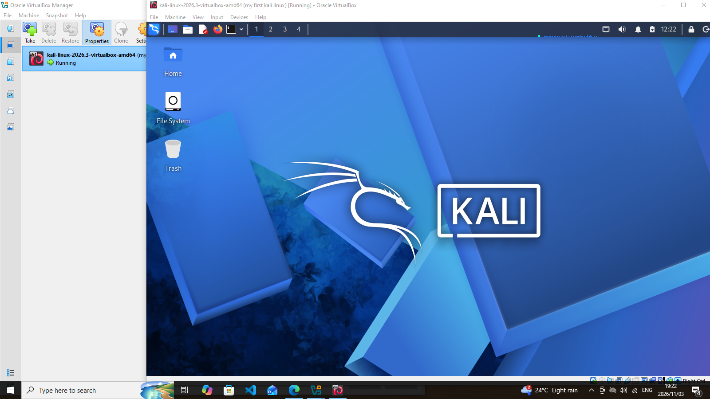
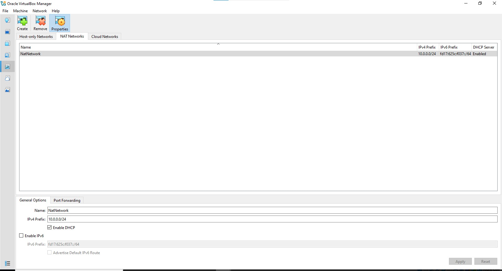
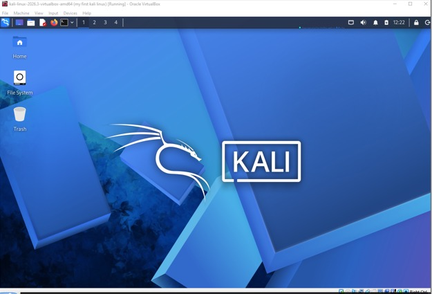
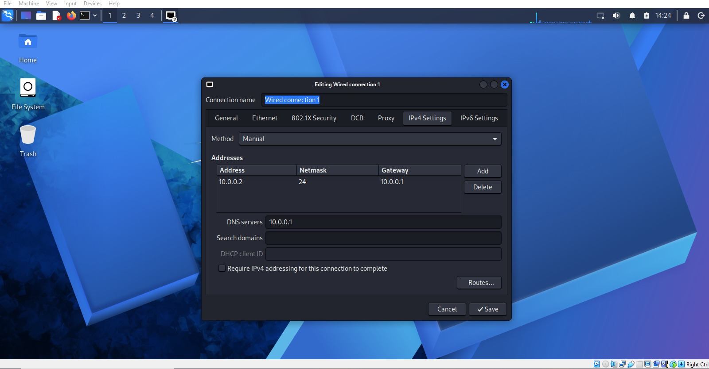

# Kali Linux Pentesting Lab on VirtualBox

A self-contained virtual lab for learning penetration testing, built with VirtualBox and Kali Linux on a private NAT Network.

---

## Overview

This project walks through building a safe, repeatable sandbox for practising security skills such as scanning, reconnaissance, and vulnerability assessment. Everything runs inside virtual machines on a private network, so experiments never touch real systems. The network is also sized to accept extra machines later, which can serve as practice targets.

## Goals

- Install VirtualBox as the virtualization platform
- Import a ready-made Kali Linux VM
- Build a private NAT Network for the lab
- Attach the Kali VM to that network and give it a fixed IP
- Confirm connectivity and DNS are working
- Save a clean snapshot to roll back to
- Record the whole process, including problems and fixes
- Leave the lab ready for later projects

## What the Lab Is For

- Network discovery and reconnaissance
- Port scanning
- Vulnerability assessment
- Traffic and packet analysis
- Web application testing
- Exploitation practice
- Trying out security tools

> **Warning:** Only use this lab against machines you own or have written permission to test. Never aim these tools at systems you are not authorized to assess.

## Architecture



Machines on the same NAT Network can talk to each other and still reach the internet through address translation.


## Environment Details

| Item | Value |
|---|---|
| Host operating system | Windows 10 |
| Host memory | 8 GB |
| Host CPU | Intel Core i7 |
| Hypervisor | VirtualBox 7.2 |
| Guest OS | Kali Linux 2026.2 |
| Guest memory | 2048 MB |
| Network type | NAT Network |
| Subnet | 10.0.0.0/24 |
| Kali address | 10.0.0.2/24 |
| Gateway | 10.0.0.1 |
| DNS | 8.8.8.8 |
| Reserved for future VMs | 10.0.0.3 – 10.0.0.99 |

## Setup Steps

### 1. Install 7-Zip
Kali's prebuilt VM images are often shipped as `.7z` archives, so 7-Zip is needed to unpack them.

### 2. Install VirtualBox
Install VirtualBox to act as the hypervisor for all lab machines.

### 3. Create the NAT Network
In VirtualBox, add a new NAT Network with these settings:


- **Name:** NatNetwork
- **IPv4 prefix:** 10.0.0.0/24
- **DHCP:** enabled
- **IPv6:** disabled

A NAT Network was chosen over plain NAT because VMs attached to it can reach each other as well as the outside world, which is exactly what an attacker-and-target lab needs.

*Figure 2: NatNetwork configured with prefix 10.0.0.0/24 and DHCP enabled*

### 4. Import Kali Linux
Download the Kali VM from the official Kali website and import it into VirtualBox. Then configure it:


- **Adapter 1:** attached to *NAT Network*, network *NatNetwork*
- **Adapter type:** Intel PRO/1000 MT Desktop
- **Memory:** 2048 MB
- **Shared folder:** set up for moving files between the host and the VM


### 5. Set the Kali IP Address
Check the existing network settings in Kali, then apply a fixed address:


```
IP address:  10.0.0.2
Netmask:     255.255.255.0
Gateway:     10.0.0.1
DNS:         8.8.8.8
```

A fixed address keeps the lab easy to document and lets later exercises refer to Kali reliably.


### 6. Take a Baseline Snapshot
Once the configuration is finished, create a snapshot, for example **Clean Kali - Network Setup**. If a later experiment breaks the VM, restore this snapshot to get back to a working state.

## Verification

| Check | Command | Expected outcome |
|---|---|---|
| IP address | `ip a` | Shows 10.0.0.2/24 |
| Gateway reachable | `ping 10.0.0.1` | Replies received |
| Internet reachable | `ping 8.8.8.8` | Replies received |
| DNS works | `nslookup networkwalks.com` | Domain resolves |
| Nmap installed | `nmap --version` | Version info printed |
| Snapshot works | Restore snapshot, then `ip a` | Original settings return |

## Troubleshooting Notes

### No internet after setting a static IP
Depending on how NetworkManager is set up in Kali, connectivity can drop after switching to a manual address. The workaround used here was to disable the duplicate address detection delay:

```bash
sudo nmcli connection modify "Wired connection 1" ipv4.dad-timeout 0
```

Restart the connection (or reboot) and test again. Connection names vary between machines, so run `nmcli connection show` first to find yours.

### VirtualBox VT-x error on startup
The VM would not boot because hardware virtualization was switched off in the BIOS/UEFI. To fix it:

1. Restart the computer and enter BIOS/UEFI setup.
2. Turn on Intel VT-x (virtualization technology).
3. Save and exit.
4. Boot Windows and start the Kali VM again.

## Key Takeaways

- **NAT vs NAT Network:** plain NAT isolates each VM, while a NAT Network lets VMs share a private segment and still get outbound access.
- **VM networking:** the adapter mode you choose in VirtualBox determines who a VM can communicate with.
- **Static addressing:** I practised setting and checking the IP, netmask, gateway, and DNS in Kali.
- **Snapshots:** take one before any risky change so you always have a known-good state.
- **Documentation:** writing down commands, settings, errors, and fixes is part of doing security work properly.

## Ethical Use

This lab is for learning and authorized testing only.

## Downloads

- 7-Zip: https://7-zip.org/download.html
- VirtualBox: https://virtualbox.org/wiki/Downloads
- Kali Linux: https://kali.org/get-kali

## Author

**Mpho**, Cybersecurity at Networkwalks (Week 01, Project: Cybersecurity & Pentesting Lab Setup)

LinkedIn: https://www.linkedin.com/in/waqaskarim/
